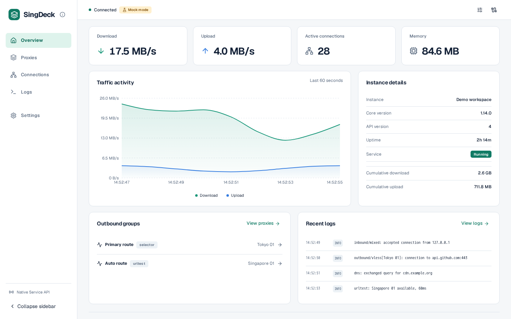

# SingDeck

[简体中文](README.zh-CN.md)

A web dashboard for **sing-box 1.14.0+ / native Service API 4**. Connect directly to your instance.

**[Try the online demo](https://knowsky404.github.io/SingDeck/)** · Choose **Explore demo** to try the dashboard without any setup.



- Live traffic, outbound groups, connections, and ANSI-colored logs.
- The current source adds live outbound inventory, native network quality and STUN tests, and configuration deprecations reported by the core.
- English/简体中文 and light/dark/system themes. On a trusted device, choose **Remember this device** to reconnect when you reopen SingDeck in the same browser.

## Run locally

Set `dashboard` in your existing `services` → `type: api` object to:

```json
{
  "enabled": true,
  "path": "./singdeck-dashboard",
  "download_url": "https://github.com/KnowSky404/SingDeck/releases/latest/download/singdeck.zip",
  "update_interval": "24h"
}
```

Use a new, writable directory. Restart sing-box, then open `http://127.0.0.1:<api-port>/dashboard/` and enter your API token. Relative paths use the core's working directory.

[Download ZIP + checksums](https://github.com/KnowSky404/SingDeck/releases/latest) · [Full example](examples/sing-box-dashboard-download.json) · [Quick start](https://github.com/KnowSky404/SingDeck/wiki/Getting-Started)

**Still seeing the old dashboard?** Try **Ctrl + Shift + R** first. See [cache troubleshooting](https://github.com/KnowSky404/SingDeck/wiki/Troubleshooting#old-dashboard-after-switching-or-updating).

## Documentation

[Native API capabilities](docs/native-api-capabilities.md) · [Verification](docs/verification.md) · [Wiki](https://github.com/KnowSky404/SingDeck/wiki) · [中文 Wiki](https://github.com/KnowSky404/SingDeck/wiki/Home-zh-CN) · [Development](docs/development.md) · [Contributing](CONTRIBUTING.md)

[AGPL-3.0-or-later](LICENSE); retain the [third-party notices](THIRD_PARTY_NOTICES.md) and corresponding source when redistributing.
