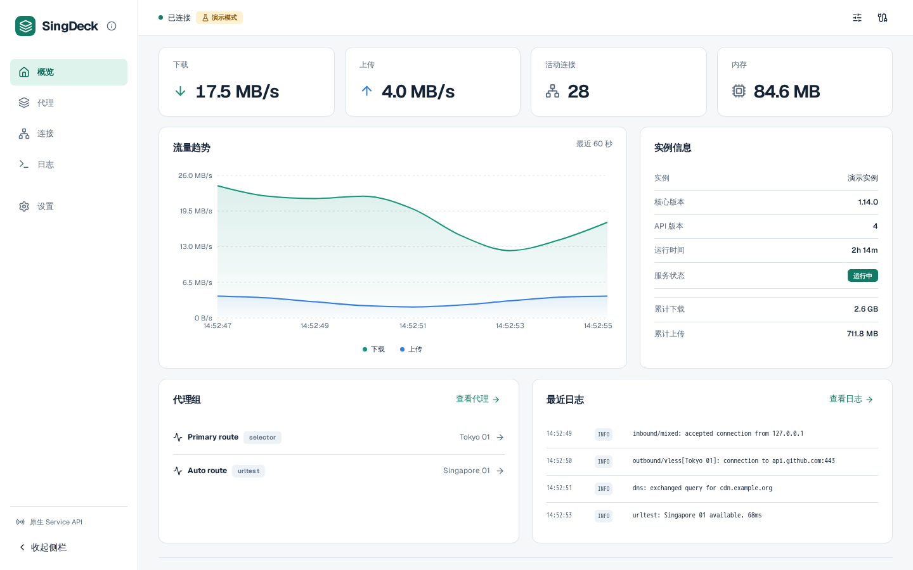

# SingDeck

[English](README.md)

面向 **sing-box 1.14.0+ / 原生 Service API 4** 的 Web 面板，可直连你的实例。

**[在线体验](https://knowsky404.github.io/SingDeck/)** · 点击「体验演示」即可试用，无需配置。



- 实时流量、出站组、连接和 ANSI 彩色日志。
- 当前源码新增全量出站清单、原生网络质量及 STUN 测试，以及核心上报的配置弃用警告。
- 连接受支持的原生实例后，可在「设置」中查看已配置的动态 USB/IP 服务及共享设备数量。
- 支持中英文及浅色、深色和系统主题。在信任的设备上勾选「记住此设备」，用同一浏览器重新打开面板时可自动重连。

## 本地使用

在已有 `services` → `type: api` 对象中，将 `dashboard` 设为：

```json
{
  "enabled": true,
  "path": "./singdeck-dashboard",
  "download_url": "https://github.com/KnowSky404/SingDeck/releases/latest/download/singdeck.zip",
  "update_interval": "24h"
}
```

使用新的可写目录，重启 sing-box。下载完成后打开 `http://127.0.0.1:<API端口>/dashboard/`，输入 API 密钥。相对路径基于核心工作目录。

[下载 ZIP 与校验文件](https://github.com/KnowSky404/SingDeck/releases/latest) · [完整配置示例](examples/sing-box-dashboard-download.json) · [快速开始](https://github.com/KnowSky404/SingDeck/wiki/Getting-Started-zh-CN)

**仍显示旧面板？** 先按 **Ctrl + Shift + R** 强制刷新，详见[缓存排查](https://github.com/KnowSky404/SingDeck/wiki/Troubleshooting-zh-CN#切换或更新后仍显示旧面板)。

## 文档

[原生 API 能力矩阵](docs/native-api-capabilities.md) · [验证记录](docs/verification.md) · [中文 Wiki](https://github.com/KnowSky404/SingDeck/wiki/Home-zh-CN) · [English Wiki](https://github.com/KnowSky404/SingDeck/wiki) · [开发文档](docs/development.md) · [贡献指南](CONTRIBUTING.md)

[AGPL-3.0-or-later](LICENSE)。分发时保留[第三方声明](THIRD_PARTY_NOTICES.md)和对应源码。
