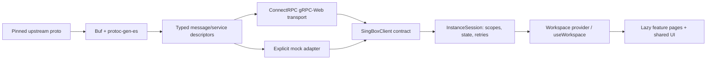

# Architecture

SingDeck is a pure frontend SPA. It talks directly to one active trusted sing-box API. Static hosting adds no server, database, account system or RPC proxy. The UI and its visual system are independent implementations.

## Responsibility boundaries

- `proto/daemon/started_service.proto`: original v1.14.0 source, pinned provenance/license in docs. `src/proto/`: generated, checked in for builds without generator/network access.
- `src/api/client.ts`: URL trust boundary, generated typed client and binary transport, authentication, redirect refusal, omitted cookies, 10-second unary deadlines. Complete service descriptors allow future methods without inventing RPCs; the adapter contract exposes the RPCs used or verified by SingDeck.
- `src/api/state.ts`: pure log/connection reducers, bounded log records, version gate and snapshot types.
- `src/api/session.ts`: one lifetime per active profile/credentials/preferences. Handshake; metadata; independent service/status/groups/outbounds/logs/connections streams; cancellation; jitter-free capped exponential retries (1–30 seconds); heartbeat on the periodic status stream. Recovery rechecks core/API compatibility and refreshes metadata; unsupported revisions abort the full scope. Idle groups/logs are valid. Ended streams and server-canceled subscriptions are interruptions. Intentional client cancellation ends the local scope. Fatal/nonretryable errors stay visible. No global transport concerns in UI components.
- `src/api/capabilities.ts` tracks five availability states per session. Read-only RPCs and stream messages update the registry. Explicit test actions supply evidence for active diagnostics. The session invalidates capability evidence when the service lifetime or compatible core changes. Optional services remain unknown until their read paths are implemented.
- `src/mocks/client.ts`: generated messages through exactly the same contract, with observable state mutations, offline recovery and one-shot mutation failure. No network; always labeled.
- `src/app/provider.tsx` and `context.tsx`: session ownership and `useSyncExternalStore` binding, theme, profile persistence and opt-in connection restore.
- `src/features/`: overview, outbounds, connections, diagnostics, configuration health, logs, settings and typed profile storage. The entry screen offers explicit real/demo choices and hides workspace navigation until the first verified status arrives. Reconnecting an entered workspace retains its data and notices; manual disconnect returns to the entry screen. Only the entry screen configures the single current service. The top-right connection menu is read-only except for retry/disconnect. Theme and English/Chinese controls are shared by entry and workspace. Each page owns only view state (search, filters, pagination, pause), not RPC framing.
- `src/components/ui/`: shadcn/Radix primitives; `shared.tsx`: a small composition layer for panels, loading/errors/empty states and selects.
- `src/styles/globals.css`: Tailwind 4 plus brand tokens and responsive composition.

## Data lifecycle

Session replacement aborts all RPCs/retries/watchdogs, clears timers and snapshot caches. Every received message checks the parent scope before commit; late old-instance messages cannot change the active workspace. UI subscriptions are removed automatically. Status, service, groups and logs stay active across routes. The All Outbounds view and Diagnostics route use the inventory stream in the fifth slot. The Groups view and other routes normally use that slot for Connections. Groups keeps the inventory stream while a queued inventory batch is active. When Connections resumes, it replaces active rows from a fresh snapshot and retains bounded closed history observed in the same core lifetime. Coverage of traffic during the pause is limited to what the core includes in that snapshot. The shared slot leaves room for RPC requests on HTTP/1.1 origins with six browser sockets. Leaving the workspace cancels all streams. Failed channels retain clearly marked stale data and can recover independently.

Updates commit at most every 100ms; periodic server status/connection samples are requested at 1, 2 or 5 seconds. Charts retain at most 300 samples in a 60–300s window. Logs retain 2,000 entries and 16K characters per message; pause freezes a bounded view while the stream continues. Connections retain 10,000 connection records, evicting closed history before active rows with a visible overflow warning and paginate rendering at 50 rows. Connection delta events increment byte totals; closed events retain final counters and the server timestamp as history; Active is the default filter. Filtering/sorting is memoized and search input is deferred. Larger deployments need server-side filtering, which the current subscription contract does not expose.

Mutations never forge subscribed state. Selector operations wait up to 8 seconds for the selected tag in a server subscription after the unary acknowledgement. URL test acknowledgement means the test started; history is authoritative and failures can be indistinguishable from untested nodes. Close operations retain rows until the server removes them. Close-all requires a modal confirmation. Outbounds reuses the `#/proxies` route and supplements group subscriptions with the independent inventory stream. The inventory mode uses core-reported tag and type while the Groups stream supplies selected paths. URL-test batch cancellation stops queued work. Native probes already dispatched can still finish on the core.

Network quality and STUN run on explicit form submission with a separate abort scope linked to the page and active instance. One diagnostic runs at a time. Service loss or navigation interrupts the scope. Reports and optional comparison history stay in memory until the Diagnostics route is left. Charts retain up to 240 measurement samples and history up to eight results per tool. User-initiated downloads exclude the custom configuration URL and API credential. Static deployment and the native adapter are shared with the rest of the app.

## Deliberate dependency choices

React 19, Vite, TypeScript strict, Tailwind 4, shadcn/Radix, ConnectRPC/Protobuf, Recharts and Lucide implement the requested core. Native hash navigation avoids server rewrites under `/dashboard/`. The session external store already owns streaming server state, so TanStack Query and Zustand would duplicate its caches; neither is added. The static workspace routes use an existing hash listener without a routing dependency. CSS transitions and reduced-motion rules cover the requested interactions without Motion. There is no untyped JSON input requiring Zod. TypeScript 6.0.3 is chosen over 7 because the current typescript-eslint release rejects TS 7.

## Profile and credential boundaries

Profiles are an array of non-secret metadata: ID, name, endpoint, TLS derived from URL, preferences, last connected time and API revision. Only one is active. The entry form edits one real profile; there is no in-workspace profile switch or sandbox UI. Demo is chosen only at entry, and profile creation/management is P1. Storage uses an allowlist; stored endpoints are revalidated. Tokens are kept in memory by default and passed to the session for error/log redaction. **Remember this device** opts in to automatic reconnect after a verified native connection. The browser keeps the AES-GCM ciphertext and its non-extractable key in IndexedDB, bound to the profile ID and exact endpoint. Local storage holds only the record ID. Manual disconnect and rejected authentication revoke automatic reconnect. Use a trusted browser profile and origin because scripts running on that origin can use the stored key. Remote HTTP is rejected; loopback HTTP is supported for SSH tunnels.

An endpoint is a highly privileged trust boundary. HTTPS certificate verification stays in the browser. Fetch refuses redirects and omits cookies. Server error strings never pass to UI; logs render as plain React text, with configured token redaction. ANSI SGR colors/styles render as React text spans (including 16/256/RGB colors); non-style controls are removed, and search/copy/export use normalized plain text. Formatting cannot split a token around redaction. There are no third-party analytics, private-config uploads or external font calls (Geist is bundled locally).

UI strings use an English/Chinese dictionary with interpolation; instance names, connection metadata and raw log messages are never translated. Language and theme persist as non-secret browser preferences. Logs and Overview recent logs default to INFO and more severe levels; changing the view filter does not mutate the core logging configuration.
