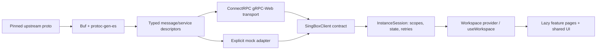

# Architecture

SingDeck is a pure frontend SPA. It talks directly to one active trusted sing-box API. Static hosting adds no server, database, account system or RPC proxy. The UI and its visual system are independent implementations.

## Responsibility boundaries

- `proto/daemon/started_service.proto`: original v1.14.0 source, pinned provenance/license in docs. `src/proto/`: generated, checked in for builds without generator/network access.
- `src/api/client.ts`: URL trust boundary, generated typed client and binary transport, authentication, redirect refusal, omitted cookies, 10-second unary deadlines. Complete service descriptors allow future methods without inventing RPCs; P0 adapter contract exposes only implemented methods.
- `src/api/state.ts`: pure log/connection reducers, bounded log records, version gate and snapshot types.
- `src/api/session.ts`: one lifetime per active profile/credentials/preferences. Handshake; metadata; independent service/status/groups/logs/connections streams; cancellation; jitter-free capped exponential retries (1–30 seconds); heartbeat on the periodic status stream. Recovery rechecks core/API compatibility and refreshes metadata; unsupported revisions abort the full scope. Idle groups/logs are valid. Ended streams are interruptions, not success. Fatal/nonretryable errors stay visible. No global transport concerns in UI components.
- `src/mocks/client.ts`: generated messages through exactly the same contract, with observable state mutations, offline recovery and one-shot mutation failure. No network; always labeled.
- `src/app/provider.tsx` and `context.tsx`: session ownership and `useSyncExternalStore` binding, memory-only tokens, theme and profile persistence.
- `src/features/`: overview, proxies, connections, logs, settings and typed profile storage. The entry screen offers explicit real/demo choices and hides workspace navigation until the first verified status arrives. Reconnecting an entered workspace retains its data and notices; manual disconnect returns to the entry screen. Connection settings share one form with the entry screen. Each page owns only view state (search, filters, pagination, pause), not RPC framing.
- `src/components/ui/`: shadcn/Radix primitives; `shared.tsx`: a small composition layer for panels, loading/errors/empty states and selects.
- `src/styles/globals.css`: Tailwind 4 plus brand tokens and responsive composition.

## Data lifecycle

Session replacement aborts all RPCs/retries/watchdogs, clears timers and snapshot caches. Every received message checks the parent scope before commit; late old-instance messages cannot change the active workspace. UI subscriptions are removed automatically. Page changes retain the active workspace streams; leaving the workspace cancels them. Failed channels retain clearly marked stale data and can recover independently.

Updates commit at most every 100ms; periodic server status/connection samples are requested at 1, 2 or 5 seconds. Charts retain at most 300 samples in a 60–300s window. Logs retain 2,000 entries and 16K characters per message; pause freezes a bounded view while the stream continues. Connections retain 10,000 active rows with a visible overflow warning and paginate rendering at 50 rows. Connection delta events increment byte totals; closed events remove active rows. Filtering/sorting is memoized and search input is deferred. Larger deployments need server-side filtering, which the current subscription contract does not expose.

Mutations never forge subscribed state. Selector operations wait up to 8 seconds for the selected tag in a server subscription after the unary acknowledgement. URL test acknowledgement means the test started; history is authoritative and failures can be indistinguishable from untested nodes. Close operations retain rows until the server removes them. Close-all requires a modal confirmation.

## Deliberate dependency choices

React 19, Vite, TypeScript strict, Tailwind 4, shadcn/Radix, ConnectRPC/Protobuf, Recharts and Lucide implement the requested core. Native hash navigation avoids server rewrites under `/dashboard/`. The session external store already owns streaming server state, so TanStack Query and Zustand would duplicate its caches; neither is added. Five static routes do not require TanStack Router. CSS transitions and reduced-motion rules cover the requested interactions without Motion. There is no untyped JSON input requiring Zod. TypeScript 6.0.3 is chosen over 7 because the current typescript-eslint release rejects TS 7.

## Profile and credential boundaries

Profiles are an array of non-secret metadata: ID, name, endpoint, TLS derived from URL, preferences, last connected time and API revision. Only one is active. P0 exposes editing one real profile and an explicit demo workspace; profile creation/management is P1. Storage uses an allowlist; stored endpoints are revalidated. Tokens are held in provider memory, tied to a profile and passed to the session for error/log redaction. There is no session-persistence option or insecure HTTP fallback. Remote HTTP is rejected; loopback HTTP is supported for SSH tunnels.

An endpoint is a highly privileged trust boundary. HTTPS certificate verification stays in the browser. Fetch refuses redirects and omits cookies. Server error strings never pass to UI; logs render as plain React text, with configured token redaction. ANSI SGR colors/styles render as React text spans (including 16/256/RGB colors); non-style controls are removed, and search/copy/export use normalized plain text. Formatting cannot split a token around redaction. There are no third-party analytics, private-config uploads or external font calls (Geist is bundled locally).
